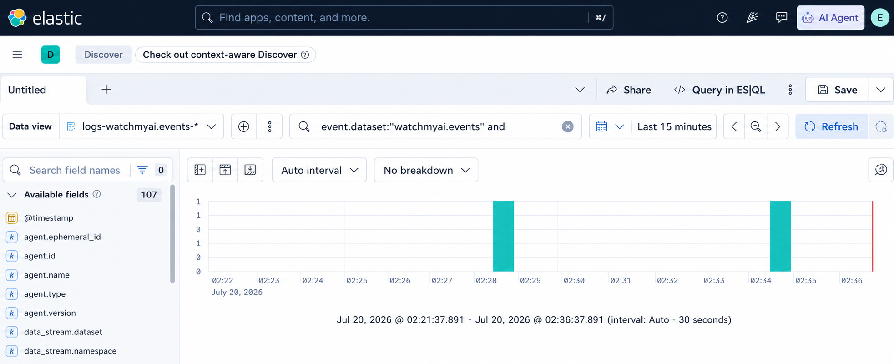
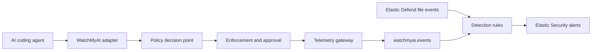
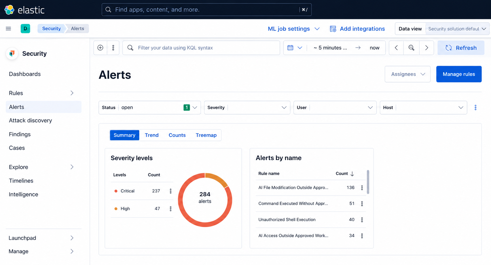

# WatchMyAI

[](https://github.com/rabbiteyesec/WatchMyAi-DaC/actions/workflows/watchmyai-ci.yml)
[](https://github.com/rabbiteyesec/WatchMyAi-DaC/actions/workflows/codeql.yml)
[](https://www.python.org/)
[](LICENSE)
[](https://github.com/rabbiteyesec/WatchMyAi-DaC/releases/tag/v2.0.0)

## Detection-as-Code for AI Agent Security

WatchMyAI monitors AI coding agent activity at supported hook and gateway boundaries, applies
policy before mediated actions execute, emits normalized security telemetry, and supplies
Detection-as-Code rules for Elastic Security. The CLI is the operator interface to this wider
runtime and detection system.

> [!IMPORTANT]
> **WatchMyAI Version 2 (v2.0.0) is here.** It adds **Sigma rule conversion with pySigma**,
> **live Windows Sysmon collection**, **agent-to-endpoint event correlation**, **MITRE D3FEND
> mapping** for all 20 production rules, an expanded automated test suite, and **one-command
> installers**. [See what is new](#watchmyai-version-2) · [Release notes](CHANGELOG.md) ·
> [Version 2 guide](docs/V2_INTEGRATIONS.md)



*Elastic Discover querying the `watchmyai.events` dataset in the WatchMyAI lab.*

## Core capabilities

- pre-tool policy decisions with `ALLOW`, `DENY`, `REQUIRE_APPROVAL`, and `MONITOR` effects;
- restrictive development policy and organization-signed production policy modes;
- policy enforcement for supported Claude Code, Codex CLI, and MCP integration boundaries;
- redacted schema 1.1.0 telemetry with durable per-session evidence chains;
- direct HTTPS export to the `watchmyai.events` Elastic dataset;
- reviewed Elastic data-stream, ingest, lifecycle, and optional investigation assets;
- 20 packaged Elastic Security rules with synchronized metadata, fixtures, and playbooks;
- static, connected, and current-run validation tools;
- Version 2 integrations: Sigma rule conversion, Windows Sysmon collection, and MITRE D3FEND mapping; and
- CLI workflows for setup, verification, validation, approvals, policy administration, and
  uninstall.

## How WatchMyAI works

1. An adapter converts a supported agent action into a canonical tool request.
2. The policy decision point classifies the action and resolves the applicable policy.
3. The enforcement point allows, denies, monitors, or holds the action for bound approval.
4. The runtime redacts and normalizes the decision and execution evidence.
5. The gateway exports schema 1.1.0 events to Elastic.
6. WatchMyAI rules correlate gateway and native endpoint evidence into Elastic Security alerts.

WatchMyAI is not a kernel sandbox and cannot control an execution path that bypasses its supported
hooks or gateways.

## Architecture overview



Eighteen production rules consume `logs-watchmyai.events-*`. `WMAI-023` and `WMAI-024` aggregate
native ECS file events collected by Elastic Defend. See the
[architecture guide](docs/ARCHITECTURE.md) for trust boundaries, policy flow, failure behavior, and
the validated deployment topology.

## One project with two internal components

| Area | Responsibility |
| --- | --- |
| [`telemetry-gateway/`](telemetry-gateway/README.md) | Policy, approvals, enforcement, evidence, adapters, normalization, export, and the `watchmyai` CLI. |
| [`detection-rules/`](detection-rules/README.md) | Rule reconciliation, validation, fixtures, playbooks, packaging, and the deferred research catalog. |
| Root tooling | Installation, setup support, import, preflight, validation, release packaging, and project metadata. |

The root [`VERSION`](VERSION), [`pyproject.toml`](pyproject.toml), [`LICENSE`](LICENSE), and release
workflow govern both components. Neither component is a separately published product.

## WatchMyAI Version 2

**Version 2 connects WatchMyAI to the tools security teams already use.** It can now turn public
Sigma detection rules into Elastic rules, collect real Windows activity through Sysmon, and label
every detection with the matching MITRE D3FEND defence, all without touching the 20 production
rules you already run.

> [!TIP]
> **Install everything with one command.**
>
> Linux / macOS: `./scripts/install/install-v2.sh`
> Windows (PowerShell): `.\scripts\install\install-v2.ps1`
>
> The installer creates its own private environment, installs exact, hash-checked versions of every
> tool, and runs the whole Version 2 toolchain so you can see it work straight away.

### Existing stack and what Version 2 adds

| Existing stack | New additions in Version 2 |
|---|---|
| Elastic Security detection rules | pySigma integration |
| Sigma research definitions | Sigma rule conversion with built-in checks |
| Sysmon-compatible queries | Live Windows Sysmon collection and health check |
| Elastic Defend | Agent-to-endpoint event correlation |
| Python validation | Expanded automated detection testing |
| MITRE ATT&CK | MITRE D3FEND mapping |
| The 20 production detection rules | 7 more Sigma-based detections, ready for review |

### What is new

| New in Version 2 | In plain words | Where to find it |
|---|---|---|
| **Sigma rule converter** | Takes community Sigma rules and turns them into Elastic detections, ready for a person to review | `scripts/sigma/` |
| **Windows Sysmon support** | Collects detailed Windows activity (programs started, files created and deleted) and sends it to Elastic | `deployment/windows/sysmon/`, `scripts/install/install-sysmon.ps1` |
| **Sysmon health check** | Confirms the Windows data arrives complete, and counts file activity against the bulk-change alert limits | `scripts/validate/verify_sysmon_ingest.py` |
| **File activity generator** | Safely creates harmless test files so the bulk-change alerts can be seen working | `scripts/validate/generate-sysmon-load.ps1` |
| **Agent-to-endpoint correlation** | Links what an AI agent did to the Windows activity it caused, and says how sure it is (confirmed, strong, probable, or endpoint-only) | `scripts/validate/correlate_agent_endpoint.py` |
| **Automated test suite** | 24 new automated checks cover the converter, Sysmon data, D3FEND sheet and correlation | `tests/test_v2_integrations.py` |
| **MITRE D3FEND mapping** | Shows which defensive technique each of the 20 rules supports, with the reason | `detection-rules/detections/mappings/` |
| **One-command installers** | Sets up and runs everything for you | `scripts/install/install-v2.sh`, `install-v2.ps1` |
| **Single runner** | Runs every Version 2 tool in order and prints a clear PASS or FAIL | `scripts/run_v2_integrations.py` |

### Built to be safe

> [!IMPORTANT]
> **Nothing is switched on behind your back.** Converted Sigma rules are saved as *disabled
> candidates* in a separate folder. They cannot be imported into Elastic or mixed into the
> production rules unless a person reviews them and decides to promote them.

- **Strict, never guessing.** If a Sigma rule uses something the converter cannot translate
  exactly, it is rejected with a clear reason instead of being approximated.
- **Repeatable.** The same input always produces the same output, and every candidate records
  where it came from (file fingerprint, tool versions, settings used).
- **Works without internet.** Conversion runs locally and never downloads anything.
- **Production rules protected.** A converted rule can never reuse the ID of a production rule.
- **Privacy-minded Sysmon setup.** Collects only what the rules need and does not archive the
  contents of deleted files.
- **Trusted install.** The Sysmon installer runs only if the download carries Microsoft's digital
  signature.
- **Honest labelling.** Windows activity is reported as *endpoint activity*, and only linked to an
  AI agent when the evidence supports it, with the confidence level shown.

### Get started

```bash
# 1. Install and run everything (Linux / macOS)
./scripts/install/install-v2.sh

# 2. See the converted Sigma rules
ls dist/sigma-candidates

# 3. Run the full set of Version 2 checks again at any time
.venv/bin/python scripts/run_v2_integrations.py
```

On a Windows lab machine, open PowerShell as administrator and run
`.\scripts\install\install-v2.ps1 -InstallSysmon` to install the tools and Sysmon together. Then
follow the three short steps in [Version 2 integrations](docs/V2_INTEGRATIONS.md) to connect Elastic
Agent and check the data.

> [!NOTE]
> The step-by-step guide for every Version 2 tool, including all commands and options, is in
> [docs/V2_INTEGRATIONS.md](docs/V2_INTEGRATIONS.md).

## Release v2.0.0 contract

| Contract | Value |
| --- | --- |
| Product version | 2.0.0 |
| Production rules | 20 |
| Excluded v2.0.0 rules | 10 |
| Deferred research rules | 45 |
| Telemetry schema | 1.1.0 |
| Canonical dataset | `watchmyai.events` |
| Validated Elastic version | 9.4.3 |
| Validated live host | Ubuntu 24.04 |
| Supported Python | 3.11 and 3.12 |
| Windows | Bootstrap installer and Sysmon integration supported |
| Dashboard | Not required |

Elasticsearch, Kibana, Fleet Server, and an enrolled Elastic Agent must already exist. WatchMyAI
does not provision that external infrastructure. Other platform versions and deployment topologies
require their own qualification.

## Quick start

Clone the repository using the URL shown by its GitHub **Code** menu. From the checkout:

```bash
cd watchmyai
./scripts/install/install.sh
# Export the Elastic and Fleet values described in docs/QUICKSTART.md.
.venv/bin/watchmyai setup --development
.venv/bin/watchmyai verify
.venv/bin/watchmyai validate
```

Development setup enables rules only because that validation mode was selected explicitly. Signed
production setup requires organization-controlled policy inputs and explicit rule enablement.
Follow the complete [quick start](docs/QUICKSTART.md) before running a connected deployment.

## Detection-rule summary

The active stable IDs are `WMAI-001`, `WMAI-002`, `WMAI-007`, `WMAI-009`, `WMAI-022`,
`WMAI-023`, `WMAI-024`, `WMAI-025`, `WMAI-030`, `WMAI-048`, `WMAI-051`, `WMAI-053`,
`WMAI-054`, `WMAI-055`, `WMAI-057`, `WMAI-058`, `WMAI-059`, `WMAI-060`, `WMAI-061`, and
`WMAI-063`.

The authoritative import-safe source is
[`deployment/rules_schema_1.1.0.ndjson`](deployment/rules_schema_1.1.0.ndjson). Rules are disabled
in source. The [detection-rule catalog](docs/DETECTION_RULES.md) documents each rule's purpose,
severity, data source, behavior, metadata, and playbook. Excluded and deferred IDs are not
supported deployment content.

## Telemetry and Elastic integration

The gateway writes to `logs-watchmyai.events-default` through reviewed schema, component-template,
ingest-pipeline, index-template, and ILM assets. Setup can also install optional Kibana data views
and saved searches. No dashboard is required.

Static validation checks schemas and generated-rule parity without external services. Connected
verification checks Elastic, Kibana, Fleet, the enrolled agent, current telemetry, and current
correlated alerts. The [Elastic integration guide](telemetry-gateway/docs/ELASTIC_INTEGRATION.md)
describes the lower-level component boundary.

## Repository structure

```text
WatchMyAI/
|-- .github/             CI, security scanning, and protected deployment workflows
|-- deployment/          authoritative production-rule source and Windows Sysmon configuration
|-- detection-rules/     internal detection component
|-- docs/                operator, security, and contributor documentation
|-- fixtures/            canonical telemetry fixtures
|-- release/             machine-readable release and validation status
|-- scenarios/           controlled rule-validation scenarios
|-- scripts/             install, import, validation, release, Sigma conversion, and Sysmon/D3FEND tooling
|-- src/                 importable watchmyai Python package
|-- telemetry-gateway/   gateway deployment assets, fixtures, tests, and component documentation
|-- tests/               project-level consistency and hardening tests
|-- VERSION              one product version
|-- pyproject.toml       one Python package and tool configuration
`-- LICENSE              one Apache-2.0 licence
```

## Lab screenshots



*Elastic Security grouping WatchMyAI alerts by severity and rule name in the WatchMyAI lab.*

Screenshots are sanitized before publication. No dashboard is required to run WatchMyAI.

## Documentation index

- [Quick start](docs/QUICKSTART.md): shortest supported checkout-to-current-alert path.
- [Documentation index](docs/README.md): guides by audience and task.
- [Installation](docs/INSTALLATION.md): platforms, packages, upgrades, and reinstalls.
- [Setup and configuration](docs/SETUP_AND_CONFIGURATION.md): complete operator workflow.
- [Configuration reference](docs/CONFIGURATION.md): inputs, defaults, validation, and secrets.
- [Verification](docs/VERIFICATION.md): static, connected, and current-alert result meanings.
- [Troubleshooting](docs/TROUBLESHOOTING.md): symptom-based diagnostics and exit codes.
- [Changelog](CHANGELOG.md): release history and notable changes.
- [Security policy](SECURITY.md): reporting and sensitive-data handling.

## Verification

Repository validation proves syntax, schemas, generated-rule parity, fixture/query behavior, and
an import dry run. It does not prove that a connected deployment currently emits alerts. Use
`watchmyai verify` and `watchmyai validate` for the connected and current-run checks documented in
the [verification guide](docs/VERIFICATION.md).

## Security

Report security issues through a private channel as described in [SECURITY.md](SECURITY.md). Never
put credentials, private infrastructure, raw operational telemetry, or unsanitized screenshots in
a public issue or commit.

## Contributing

[CONTRIBUTING.md](CONTRIBUTING.md) defines supported environments, generated-file boundaries,
validation commands, rule reconciliation, documentation standards, and screenshot requirements.

## Licence

WatchMyAI is licensed under the [Apache License 2.0](LICENSE).
